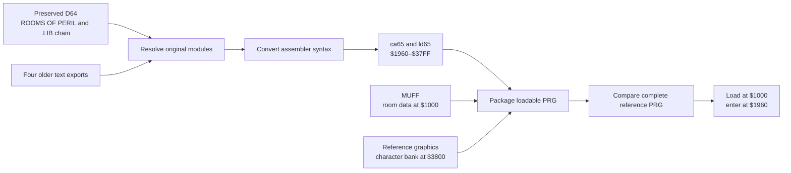
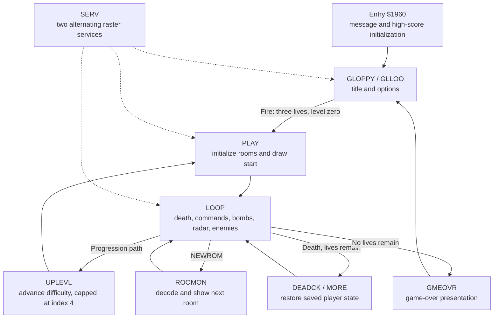
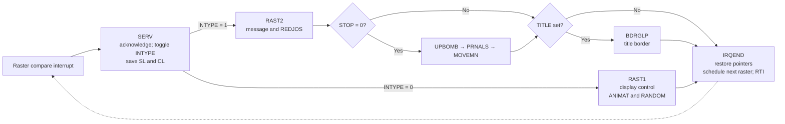
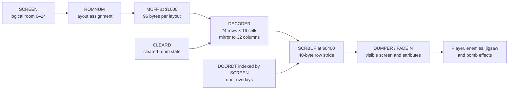
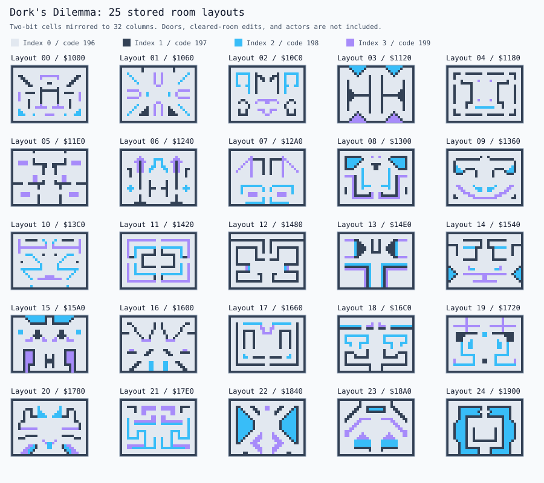
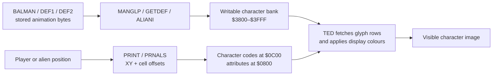

# Dork's Dilemma – Codebase Analysis

## Purpose, Scope, and Evidence

This document explains how the working game fits together, for anyone who wants to **modify it, learn from it, or build new versions on other platforms**. It ties the original modules, game state, data, and hardware dependencies together so that changes can be made with a clear idea of how the game works.

The authentic C16 restoration is the reference. A new version can change the rules, presentation, controls, or platform, as long as it's clear which behaviour came from the original and which was changed on purpose. The current restoration build stays as the reproducible baseline. There is no separate development source tree or build target for modified versions yet.

This analysis was updated on 20 October 2026 against the recovered source, the generated assembly, the linker map, and the current restoration scripts. [Restoration Status](docs/RESTORATION_STATUS.md) has the verification evidence and [Source to VICE](docs/SOURCE_TO_VICE.md) has the build instructions.

Read it alongside the [generated code reference](docs/analysis/CODE_REFERENCE.md), the [machine-readable index](docs/analysis/codebase-index.json), and the [extracted asset data](docs/analysis/asset-data.json). The reference lists every active module, where it came from, the zero-page allocations, and the symbols with their addresses and logical source-line numbers. Treat these as navigation aids: a label isn't necessarily a function, and static transfers don't cover every path the game can take at runtime.

The diagrams describe the working source, and the room and character atlases decode real game bytes. Proposed changes and port architecture are marked as future work. The emulator evidence covers startup and entry into gameplay, not a full play-through.

---

## Game and Verified Baseline

Dork's Dilemma is a room-based action game built around a 5 × 5 room grid, jigsaw pieces, enemies, and bombs. The code keeps a room's logical position separate from its assigned layout and jigsaw data, so a room is game state as well as a picture.


*The restored build entering gameplay in VICE. The room-layout atlas below isolates the stored scenery from the live display.*

I wrote the game at Micro-Projects Ltd. under the development name **Rooms of Peril**. Gremlin Graphics in Sheffield renamed it **Dork's Dilemma** when it published and launched the game in 1985. The main source gives 5 March 1985 as the start of development.

The development machine was a C64 with a 1541 drive. Source was edited and assembled on that machine, then loaded and tested on the C16 through the shared, daisy-chained drive. The recovered assembler calls itself Commodore's resident assembler. It has a BASIC startup stub, but that doesn't make it an assembler written in BASIC. Parts of the historical workflow are still pieced together from the files. See [Development History](docs/DEVELOPMENT_HISTORY.md).

The earlier text conversion probably dates from 1992, going by my recollection and the surviving index timestamps. It shouldn't be called a confirmed studio archival process. Whether the surviving reference binary is a release or a development build is unknown.

### Current Result

| Property                | Verified baseline              |
| ----------------------- | ------------------------------ |
| Target configuration    | PAL C16, 16 KB RAM             |
| Assembled program bytes | 7,840                          |
| Complete PRG bytes      | 12,290                         |
| PRG load address        | `$1000`                        |
| Program entry           | `$1960` / `SYS 6496`           |
| Reference comparison    | Byte-identical complete PRG    |
| Active assembly inputs  | 46, including the main file    |
| Build checks            | Seven regression tests passing |

All program bytes are assembled from source. The final character graphics come from the reference binary's graphics region, because the standalone character file differs in 142 bytes. Four source modules come from the older text conversion, as described below.

VICE checks have confirmed that the title screen renders and that the game reaches its main loop on a 16 KB PAL C16, using a scripted fire-input flag. Those automated checks stop at startup and gameplay entry. [Testing](TESTING.md) lists the manual checks still to do.

---

## Repository and Source Organization

The active build starts from `Dorks-Dilemma-C16-2026-FullDiskCopy/Dorks-Dilemma-C16.d64`, whose live directory has 66 files. It follows the original `ROOMS OF PERIL` `.LIB` directives and doesn't assemble the loose files beside the image or the earlier consolidated files in `src/`.

The image has the full continuation of `FILLER-BOMB`, including `FILLEX`, `CHKBMB`, and `CLEXP`, so the build now uses original source for these routines instead of the earlier guessed versions.

Four active include references have no matching live directory entry. The build supplies their surviving older copies explicitly:

| Original disk module | Earlier source input          |
| -------------------- | ----------------------------- |
| `RASTER-ROUTINES`    | `Original_Files/RASTERRO.TXT` |
| `ALIENS-MEGA/CODE`   | `Original_Files/ALIENSME.TXT` |
| `ALIEN-CHEK/PRINT`   | `Original_Files/ALIENCHE.TXT` |
| `WHOOPPEE-MESSAGE`   | `Original_Files/WHOOPPEE.TXT` |

Those text exports are converted to upper case for assembly. Matching the full program region checks the resulting instructions and embedded data against the reference, but it doesn't recover the missing modules' original disk-file bytes.

### Module Responsibilities

| Concern                | Main module examples                 |
| ---------------------- | ------------------------------------ |
| Entry and definitions  | `ROOMS OF PERIL`, `VARS`             |
| Hardware and storage   | `MAIN-VARS`, `EXTRA-MEMORY`          |
| Foreground loop        | `PLAY-GAME`                          |
| Raster scheduling      | `IRQ`, `RASTER-ROUTINES`             |
| Title and choices      | `MAGNIFICENT`, `ALTERABLES`          |
| Input                  | `JOYSTIK`, `KEY-SCAN`, `INKEY`       |
| Player and collision   | `MOVE-PIXEL`, `CHECK-MAN`            |
| Room transitions       | `CHANGE-ROOM`                        |
| Room setup and display | `INIT-ROOMS`, `DECODER`, `DUMPER`    |
| Jigsaw logic           | `SCATTER`, `JIGSAW-CODE`             |
| In-game editing        | `COMMAND`, `EDIT-JIGSAW`             |
| Bombs and explosions   | `BOMB-CODE`, `FILLER-BOMB`           |
| Enemy movement         | `ALIENS-MEGA/CODE`                   |
| Enemy drawing and hits | `ALIEN-CHEK/PRINT`, `KILLER-CODE`    |
| Death and game over    | `DEATH-CODE`, `GAME-OVER`            |
| Difficulty             | `LEVEL-INCREASE`                     |
| Scoring                | `SCORE-ROUTINES`, `WORK-HIGH`        |
| High-score display     | `HIGH-PRINT`, `HALL-OF-FAME`         |
| Interface and radar    | `SCREEN-INIT`, `RADAR-SCANNER`       |
| Character effects      | `ANIMATE-CHARS`, `VARIETY`           |
| Presentation           | `BORDER`, `TITLE-WORKS`              |
| Scrolling message      | `MESSAGE-STUFF`, `WHOOPPEE-MESSAGE`  |
| Shared helpers         | `UTILS`, `TABLES`, `MACROS`, `SETUP` |

The [generated reference](docs/analysis/CODE_REFERENCE.md#modules-in-assembly-order) lists the full 46-module assembly order and how many bytes each module adds to the program region. Definitions and macros can add no bytes themselves and still be essential inputs.

### Files to Read During Analysis

`build/disk/` holds the extracted disk files with their original contents. `build/recovered-c16.s` is the generated assembly in include order, with source-module comments, and `build/recovered-c16.lst` shows the assembled instructions and addresses.

`build/labels.txt`, `build/map.txt`, and `build/dorks.dbg` tie labels to memory. `build/recovery-manifest.json` has the input provenance and hashes, and `build/comparison.json` has the reference comparison and the graphics dependency. All of these are generated, and `./build.sh` recreates them.

The older `src/main.s`, `src/main_ca65.s`, and repair routines are still useful for following the restoration history, but they have known conversion defects and aren't build inputs. Editing them won't change the current output. See [the source-folder note](src/README.md).

---

## Build Architecture

`build.sh`, the Makefile, and PlatformIO all use `scripts/restore_c16.py`. The disk reader is `scripts/d64_image.py`; the linker layout is `config/c16.cfg`.

The pipeline reads the preserved image, resolves the original includes, converts the assembler syntax, assembles and links the program, adds the screen and character data, and compares the complete PRG with the reference. A missing or ambiguous include, an assembler or linker failure, code that overlaps the character set, and any difference from the reference all stop the build.



PlatformIO's `c16` and `c16_debug` environments produce the same game bytes under their own `build/platformio/` directories, and the debug information doesn't change the program. PlatformIO only uses the native platform as a build context for the custom assembly pipeline, so the game doesn't become a native host executable.

The VICE launcher waits for initialization, loads the PRG at its saved address, and enters at `$1960`. The PRG has no BASIC `RUN` stub. The [PlatformIO Guide](docs/PLATFORMIO_GUIDE.md) has the current commands.

---

## Runtime Architecture

The foreground loop and the raster interrupt services share writable memory, and input, movement, bomb effects, and enemy logic are spread across both. A port has to keep that relationship as well as the rules inside each routine.



*This is a control-flow overview. It groups helper calls and presentation sequences instead of treating every branch label as its own game state.*

### Startup, Title, and Foreground Loop

`ROOMS OF PERIL` defines constants, variables, macros, initialization, and include order. Entry at `$1960` initializes the message pointer and high-score data, then transfers to `GLOPPY` in `MAGNIFICENT`.

`GLOPPY` configures the title presentation and interrupts. `GLLOO` handles title options and waits for fire. The fire path clears the title and level flags, sets three lives, and enters `PLAY`.

`PLAY` initializes a game, prepares rooms and jigsaw placement, and draws the starting room. Its foreground `LOOP` handles death, commands, bomb processing, requested room changes, radar updates, and tempo-controlled alien movement. It delegates frequent animation and input work to the interrupt path.

### Interrupt Work and Shared State

`IRQ` installs the interrupt handler and alternates between two raster services. `RASTER-ROUTINES` supplies `RAST1` and `RAST2`: one updates character animation and randomness, while the other handles the scrolling message, input, and selected gameplay updates.

When `STOP` permits gameplay work, the raster service also updates bombs, prints aliens, and moves the player. `TITLE` controls title-specific work. The handler saves and restores shared screen pointers around interrupt processing.



`RASVAL` stores `$C1, $00`. Setup schedules `$C1` with `INTYPE = 0`. The handler toggles the index before dispatch, so that first interrupt runs `RAST2` and schedules `$00`, and the next runs `RAST1` and schedules `$C1`. These are raster compare values, not millisecond timers, and busy waits and foreground work also affect the game's tempo.

`CLVARS` clears `$0007–$00FF` and leaves the message pointer, message pixel offset, lives, and extra-life state at `$0002–$0006` alone. Choices stored elsewhere, such as `JOYSEL`, `SNDFLG`, and `LEVEL`, sit outside that clearing range. A new engine should define session, level, and life resets separately.

A port should make this split explicit. If everything moves into a host application's frame callback without regard for order, update rates, and shared state, collision behaviour, movement tempo, and the order of events can change even when every routine is translated correctly.

---

## Memory and Data Model

### Allocations in the Working Build

These addresses come from the current linker map, labels, original definitions, and packaged assets. They fix the earlier analysis, which cut the zero-page range short and mixed up the load and entry addresses.

| Address range     | Role                                  |
| ----------------- | ------------------------------------- |
| `$0002–$00C2`     | Game zero-page variables, 193 bytes   |
| `$0200–$02F3`     | Runtime tables, 244 bytes             |
| `$0400–$07BF`     | Room decode buffer, 960 bytes         |
| `$0800–$0BFF`     | Display attributes and related space  |
| `$0C00–$0FE7`     | Visible character screen, 1,000 bytes |
| `$1000–$195F`     | `MUFF` screen data, 2,400 bytes       |
| `$1960–$37FF`     | Assembled program, 7,840 bytes        |
| `$3800–$3FFF`     | Character graphics, 2,048 bytes       |
| `$FF00` and above | TED hardware register definitions     |

`SCRBUF = $0400` is the off-screen room buffer, not a display address entered by mistake. `DECODER` builds room data there, and `DUMPER` copies it to the visible screen with an effect. The screen-address table in `UTILS` starts at `$0C00`.

The program fills its whole configured region up to the character set, with no unused space at the end. Adding code or embedded tables means changing the memory layout or freeing space elsewhere. A larger-memory edition or a port has to work out its own layout.

### Important State

| Symbol or table | Address      | Meaning                            |
| --------------- | ------------ | ---------------------------------- |
| `MESL`          | `$02–$03`    | Scrolling-message pointer          |
| `LIVES`         | `$05`        | Remaining lives                    |
| `RND`           | `$0E–$11`    | Four-byte random state             |
| `SL`            | `$13–$14`    | Screen/work pointer                |
| `SCREEN`        | `$1D`        | Current logical room               |
| `XPOS`, `YPOS`  | `$1E`, `$1F` | Position within the room grid      |
| `MANX`, `MANY`  | `$21`, `$24` | Player cell position within a room |
| `CL`            | `$2E–$2F`    | Display-attribute pointer          |
| `XPIX`, `YPIX`  | `$30`, `$31` | Fine movement offsets              |
| `JIGNUM`        | `$0200`      | 25 room-to-jigsaw mappings         |
| `ROMNUM`        | `$0219`      | 25 room-to-layout mappings         |
| `RADBUF`        | `$0232`      | 25 radar entries                   |
| `ALIBUF`        | `$024B`      | 64-byte alien animation buffer     |
| `GOTBIT`        | `$028B`      | 25 room-clear flags                |
| `HISTBL`        | `$02A4`      | 80-byte high-score table           |

Room-grid coordinates, player cell coordinates, and fine pixel offsets are three different things. Keep them apart if you add a higher-resolution renderer or a different movement system. The source describes `GOTBIT` as tracking cleared rooms, but trace collection and completion through the jigsaw routines instead of guessing from the table's name.

---

## Guide to the Game Modules

The names here are the original disk-module names. The source comments in the generated assembly make them searchable, so you don't have to rely on the older shortened PC filenames.

### Definitions and Utilities

`MAIN-VARS`, `VARS`, and `EXTRA-MEMORY` define hardware addresses and storage. `MACROS` supplies double-precision increment/decrement operations. `UTILS` includes randomness, delay, clearing, coordinate-to-screen calculation, and bomb-character copying; `TABLES` holds shared lookup data.

As a learning exercise, trace `XY` from coordinates to `SL` and `CL`, then look at its callers. You'll see how rendering, attributes, and collision checks all share the original character-screen representation.

### Input and Movement

`JOYSTIK`, `KEY-SCAN`, and `INKEY` provide controller and keyboard scanning. `ALTERABLES` changes input and sound selection. Direction and fire state are communicated through `JLEFT`, `JRIGHT`, `JUP`, `JDOWN`, and `JFIRE`.

`MOVE-PIXEL` combines drawing, movement candidates, fine animation, and accepted positions. `CHECK-MAN` validates the player's surroundings; `CHANGE-ROOM` recognizes doors and performs room transitions. `COMMAND` invokes in-game editing through the original command path.

The source uses `Z`/`X` for left/right, `;`/`/` for up/down, and Space for fire/start. Keyboard is the default, and the joystick routine can check both controller ports. How VICE maps these to host keys is a separate matter.

| Action              | Source keyboard control |
| ------------------- | ----------------------- |
| Left / right        | `Z` / `X`               |
| Up / down           | `;` / `/`               |
| Fire / start        | Space                   |
| Keyboard / joystick | `F1`                    |
| Sound selection     | `F2`                    |

`REDJOS` picks keyboard or joystick scanning from `JOYSEL`. The joystick path tries two port-select patterns and doesn't fall back to the keyboard on its own. Direction and fire tests read the high bit of their flags, so replacing those bytes with a boolean `1` would change what instructions such as `BIT JFIRE` do.

### Rooms and Graphics

`SETUP` configures TED. `DECODER` expands a room selected through `ROMNUM` into `SCRBUF`, including a mirroring stage. `DUMPER` transfers the decoded buffer to the visible screen with a fade effect; it is not a screen-memory dump utility.

`SCREEN-INIT`, `BORDER`, and `TITLE-WORKS` handle the interface, borders, and title effects. `ANIMATE-CHARS` and `VARIETY` do the character animation and alien graphics. `RADAR-SCANNER` draws the room overview, and `MESSAGE-STUFF` scrolls the text, with the message data coming from `WHOOPPEE-MESSAGE`.

Some graphics change by rewriting character memory, and a new renderer has to allow for that. If it treats every glyph as a fixed texture, it will miss part of the original animation system.

### Rooms, Jigsaw, and Bombs

`INIT-ROOMS` prepares the logical room tables. `SCATTER` distributes jigsaw pieces, `JIGSAW-CODE` handles their game logic, and `EDIT-JIGSAW` provides the original jigsaw-editing functionality.

`BOMB-CODE` handles bomb state, timing, and effects. `FILLER-BOMB` does the expanding fill, `CHKBMB` validates positions, and `CLEXP` clears the explosion characters. A change to the bomb rules therefore touches both the logical state and the screen-character tests.

The room count is baked into several places, including 25-entry tables and initialization loops. Adding rooms is a structural change, and appending more compressed screen data isn't enough.

### Enemies, Progression, and Scores

`ALIENS-MEGA/CODE` moves enemies; `ALIEN-CHEK/PRINT` handles checking and printing them. `KILLER-CODE` manages enemy-kill logic. `DEATH-CODE` and `GAME-OVER` handle failure and end-of-game flow.

`LEVEL-INCREASE` supplies level-dependent values such as enemy movement tempo and kill requirements. `SCORE-ROUTINES`, `HIGH-PRINT`, `HALL-OF-FAME`, and `WORK-HIGH` cover scoring, table data, display, and high-score entry.

When tuning difficulty, follow the values into their counters and comparisons. A lower delay or tempo value can mean more activity, so changing a table without knowing how it's read can give the opposite of what you intended.

### Separate Tools and Inactive Code

`DESIGNER`, `DES-IRQ`, and `DES-ANI` belong to the separate screen-design tool and aren't in the main game's active include chain. `HEXER` is commented out in the main source. These programs need their own build and testing before anyone treats them as working modern editing tools.

The disk's `EDITOR` program is the Commodore source editor, not the game's level editor. `OBJ` and `O.DES` are hexadecimal object records, not assembly source. PRG files can hold tools, BASIC, or data, and [Recovered Disk and Folder Contents](docs/RECOVERED_DISK_CONTENTS.md) catalogues their roles separately.

---

## Rooms, Layouts, and Display Construction

`INIT-ROOMS` fills `ROMNUM` and `JIGNUM` with permutations. `SCREEN` is the current logical room, and `ROMNUM[SCREEN]` picks its stored layout. `GOTBIT` tracks cleared rooms, and `DOORDT[SCREEN]` gives the door mask for that grid position. Each of these tables has 25 entries, but they do different jobs.



Each packed byte supplies four two-bit indices. `DECODER` adds 196 to produce character codes 196–199, writes the left half, and mirrors it. The 32-cell room occupies rows with a 40-byte stride in the 960-byte buffer. Cleared rooms are rebuilt before mirroring; doors are inserted afterwards.

### Stored Room Atlas



*These are layout templates, not a fixed map of the 5 × 5 room grid. Colours distinguish raw indices 0–3, corresponding to character codes 196–199. Runtime doors, cleared-room edits, actors, and the game's actual glyph shapes and colours are omitted.*

The [asset data](docs/analysis/asset-data.json) keeps each layout's 96 source bytes and its decoded 32 × 24 index grid, along with the door table. A room editor or port can start from that without touching the original image.

The room count feeds into initialization, navigation, the radar, jigsaw assignment, and saved room state. Expanding the grid means tracing every one of those as well as adding layout data.

---

## Game Graphics, Assembly, and Screen Display

The current build takes screen data from `MUFF` and the final character set from the reference binary's `$3800–$3FFF` region. Standalone `CHARS` differs in 142 bytes, so producing the final graphics without the reference, from the other assets and utilities, is still a research task. No executable code is copied from the reference.

Character bitmaps, character-screen codes, text encodings, and display attributes are four different representations, and a new platform needs explicit conversions between them. Collision and explosion routines also read character values, so a visual redesign can change gameplay unless those rules are kept apart from the renderer.

Alternative character sets and support programs survive on the disk, but their names don't say what they were used for in production. Work out how they relate to the final game assets before a new edition depends on them.

### How to Read the Graphics Sheets

The images below rebuild named game graphics from the **verified PRG's bytes and assembled data tables**, keeping the tile order the drawing routines use. `scripts/game_graphics.py` generates them when `scripts/analyze_codebase.py` runs. They aren't artist impressions, and they aren't guessed from asset filenames.

In the multicolour previews, each byte holds four two-bit samples, shown as four pairs of horizontal screen dots. The four inspection colours stand for the values `00`, `01`, `10`, and `11`. They match the index colours of the existing multicolour atlas on purpose and don't try to emulate the TED palette. The one-bit previews show eight separate dots per byte. The annotated VICE screenshot below shows how the game really looks. The sheets explain the shapes and storage underneath.

### Main Character: Dork


The stationary character is a **2 × 2 tile image**, occupying 16 × 16 screen dots. `BALMAN` in `ANIMATE-CHARS` stores four frames of 32 bytes each: eight bytes for the top-left tile, eight for the top-right, then the bottom-left and bottom-right. `MANGLP` copies the chosen frame into `$38E0–$38FF`, which defines character codes 28–31. Its counter visits frames 0, 1, 2, 3, then alternates 2 and 3 while the idle animation continues. `GLOPTM` controls the interval; these are not four frames displayed on every interrupt.

`PRINT` in `MOVE-PIXEL` selects a different representation while moving. Horizontal phases use codes **148–171** in four consecutive six-character groups, placed in a **3 × 2** rectangle using `WALY = 0,1,2,40,41,42`. Vertical phases use codes **172–195** in four six-character groups, placed in a **2 × 3** rectangle using `YVAL2 = 0,1,40,41,80,81`. `TIME6 = 0,6,12,18` selects the group from `XPIX` or `YPIX`. The wider or taller blocks leave space for the shifted image; the entire block is not solid character artwork.

At a cell boundary, `NORMPR` writes codes 28, 29, 30, and 31 in a 2 × 2 arrangement. Its initial pointer can be one row above the final top-left cell, and horizontal facing adjusts the column. The `YCHIN` offsets 40, 41, 80, and 81 account for that positioning. Both stationary and moving player cells receive attribute `$79`. `BUGRUB` clears the previous footprint selectively, replacing player codes with floor code 196.

### Aliens: Eight Designs, Two Frames Each


The source calls these designs **GONK #1–#8**; their stored type indices are 0–7. `DEF1` and `DEF2` in `VARIETY` each contain 256 bytes: eight designs × 32 bytes per frame. Each frame has the same top-left, top-right, bottom-left, bottom-right tile order as the stationary player.

`GETDEF` chooses the room's alien design, or reuses the previous type when `DUCK` requests it, and copies its two frames into the 64-byte `ALIBUF` at `$024B`. `ALIANI` alternates between the two 32-byte halves and copies the selected frame to `$3E88–$3EA7`, defining codes **209–212**. The animation countdown reloads with 20; it is separate from the alien movement tempo.

`PRNALS` maintains four alien slots. For each live slot it erases the previous four screen cells with code 196, then writes **209, 210 / 211, 212** at the new address, with attribute `$7C`. All live aliens share those four glyph definitions, so they share a design and animation phase. Their positions live in separate movement and print tables. Eight designs therefore do not imply eight independently selected designs on one screen.

### Bombs, Scenery, Jigsaw, Radar, and Effects


| Graphic            | Codes or storage | Assembly and drawing      |
| ------------------ | ---------------- | ------------------------- |
| Planted bomb       | 244–247          | `BOMPRT`, 2 × 2 tiles     |
| Bomb charge icon   | 44–47            | `COPYBM` and `READY`      |
| Explosion fill     | 248 / `$3FC0`    | `FILBMB` and `ANIEXP`     |
| Floor and scenery  | 196–199          | `DECODE` and `FADEIN`     |
| Door               | 200              | `DOORDT` overlay          |
| Radar room markers | 201–202          | `RADAR`, 5 × 5 cells      |
| Box edges/corners  | 203–208          | Jigsaw and sidebar frames |
| Jigsaw pieces      | 215–239          | One eight-byte glyph each |
| Enlarged piece     | 240–243          | `PRPICE`, 2 × 2 tiles     |
| Death animation    | 33–36            | `DEADCK`, mutable glyphs  |

**Bomb and explosion.** `BOMPRT` writes codes 244, 245 / 246, 247 using the first four `YVAL2` offsets. It changes the attribute during the countdown to flash the bomb. `COPYBM` copies the same 32 bitmap bytes from `$3FA0` into the sidebar charge glyphs at `$3960–$397F`. `READY` rebuilds the charge image upward over time. Explosion cells use code 248; `ANIEXP` continually replaces that glyph's eight bytes using reads from `$8000,X`. Its live texture therefore cannot be represented by one definitive stored frame.

**Scenery and borders.** The packed room data selects codes 196–199, then the decoder inserts doors as code 200. `ANIMAT` copies `BRIK3`, `BRIK1`, and `BRIK2` frames into codes 198, 199, and 200. It also animates horizontal and vertical border glyphs 203 and 204 using `XDAT` and `YDAT`. The initial bank and runtime appearance consequently differ even when no actor moves. The sheet includes both initial scenery and the first replacement brick frames.

**Jigsaw.** Codes 215–239 contain the 25 small, one-bit jigsaw pieces. `PRPICE` selects a piece through `JIGNUM[SCREEN]`, copies its eight bytes into `JIGBUF`, and uses `XPAND` to duplicate each bit horizontally, then duplicates rows vertically. This creates four glyphs at `$3F80–$3F9F`. Their arrangement is **240, 242 / 241, 243**, because the expansion stores the entire left column before the right. `JIGCHR` surrounds them with a 4 × 4 cell frame; the piece cells use attribute `$42` and the frame uses `$71`. `TRANSF` later places the original small glyph in the sidebar's collection area.

**Radar and death.** `RADAR` places 25 room-marker characters in the sidebar. It rewrites code 202 at `$3E50` with a marker derived from `MANX` and `MANY`, then uses that glyph for the current room; the sheet's marker is an illustrative position. `DEADCK` copies the player's current stationary glyphs into temporary codes 33–36, arranged **33, 35 / 34, 36**, scrolls them away, and scrolls in the `CROSSL` and `CROSSR` pattern. The cross shown is reconstructed from those pattern tables, rather than presented as an unchanged initial-bank asset.

### From Bitmap Bytes to Visible Screen Cells


The game uses a character display. Moving figures are drawn in software by changing screen cells and writable character definitions, and the drawing code doesn't allocate a hardware sprite for Dork or an alien. For character code `n`, the bitmap starts at **`$3800 + 8*n`**, and each of its eight bytes is one row.

`XY` converts a cell coordinate into `SL = $0C00 + 40*y + x` and `CL = SL - $0400`. The screen holds character numbers, and the matching attribute cells set the display colours and how each cell is read. For example, placing stationary Dork at top-left cell `(10,6)` writes codes 28, 29, 30, and 31 at `$0CFA`, `$0CFB`, `$0D22`, and `$0D23`, and attributes `$08FA`, `$08FB`, `$0922`, and `$0923` each get `$79`. The coordinate is a worked example and doesn't say where the player is in the capture.

`SETUP` selects RAM character graphics and the bank at `$3800`, turns on the game's display mode, and sets `BACKGR`, `MULTI1`, and `MULTI2` to `$11`, `$00`, and `$46`. Display colours can change later during the title, fades, and effects. A screen code can animate without moving when its eight glyph bytes change, and movement changes which codes sit in which cells instead. A port has to reproduce both.



### How the Whole Screen Is Composed


The character screen has **40 columns × 25 rows**, representing 320 × 200 screen dots before border and emulator scaling. The room uses columns 0–31 and rows 0–23, or 256 × 192 dots. The sidebar uses columns 32–39. Row 24 contains the scrolling message. The rectangles above mark those regions on the existing gameplay-entry capture; they do not add game content to the screenshot.

`DECODE` expands the selected room into `SCRBUF` with a 40-byte row stride. `FADEIN` copies scenery and door codes to `$0C00` and their attributes to `$0800`, varying the brightness during the transition. Blank cells in the room use code 196. `PRPICE` adds the central jigsaw display, and the actor and bomb routines overwrite cells as play goes on. It's one shared tile surface, not a stack of separately composited image layers, and the screen codes also feed collision and hit detection.

`PRBDER` and `SETWIN` build the sidebar frame and labels, `READY` updates its bomb icon, `TRANSF` populates the collected-piece area, and `RADAR` draws the map. The bottom message uses `MESSVE` and raster-controlled fine scrolling. `RAST1` restores the main area's display settings and calls `ANIMAT`; the alternating `RAST2` service scrolls the message, then performs `UPBOMB`, `PRNALS`, and `MOVEMN` when gameplay is enabled. See the interrupt diagram above for the scheduling detail.

### One-Bit Character Atlas


*All 256 initial eight-byte glyphs from `$3800–$3FFF`, shown as eight one-bit pixels per row. Labels give the decimal character code and hexadecimal byte address. This view makes text and fine patterns easier to inspect.*

### Two-Bit Character Atlas


*The same bytes interpreted as four two-bit pixel pairs per row. Preview colours identify raw indices; they are not a reconstruction of TED palette selection. Actual display depends on character attributes, display settings, and runtime changes to character memory.*

Both views are worth having, because how a byte is read depends on the display mode. The sheets show only the initial bank. `ANIMATE-CHARS`, `VARIETY`, and other drawing code change glyph contents at runtime, so no sheet can show every animation frame or presentation state.

---

## Routine Contracts and Assembly Assumptions

These are good places to start when reading the listing. The addresses are for the current authentic build and can change in a modified edition.

| Entry    | Address | Contract or caution                   |
| -------- | ------- | ------------------------------------- |
| `REDJOS` | `$19D3` | Updates input flags via selected mode |
| `SERV`   | `$1A3C` | IRQ entry; exits through `IRQEND`     |
| `DELAY`  | `$1AD9` | Some callers enter at `DELAY+2`       |
| `CLVARS` | `$1AE7` | Clears `$0007–$00FF`                  |
| `XY`     | `$1B0E` | X/Y cells → `SL` and `CL` pointers    |
| `DECODE` | `$1C12` | Room state → `SCRBUF`; patches code   |
| `CHECK`  | `$1FA2` | Candidate cells → collision state     |
| `FADEIN` | `$2192` | Buffer → display with effects         |
| `FILLEX` | `$2A97` | Expanding bomb-fill work              |
| `CHKBMB` | `$2AC5` | Bomb-position validation              |
| `CLEXP`  | `$2AFA` | Clears explosion characters           |

`XY` takes the column in X and the row in Y and computes the character-screen pointer `SL` and the attribute pointer `CL`. Callers use that screen representation for drawing and collision. `YVAL2` holds six offsets, but `CHECK`'s loop uses only four: 0, 1, 40, and 41. A table's length doesn't tell you how much of it each caller uses.

`DECODER` patches the operands at `SELFMD`, `LMIRR`, and `RMIRR`. `JOYSTIK` switches `XTRCDE` between `LSR A` and `NOP` to normalize fire input for the selected port. A direct translation to a platform with read-only code should replace those tricks with explicit pointers and branches.

Register constants have to stay equates, and instructions after labels have to survive conversion. Both caused defects in the earlier reconstruction. Be careful too with calls into the middle of routines, fixed character numbers, zero-page pointer pairs, and state owned by the interrupt when you refactor.

---

## Generated Analysis Statistics

| Measure                   | Value |
| ------------------------- | ----- |
| Active modules            | 46    |
| Logical source lines      | 7,598 |
| Instruction-like lines    | 2,949 |
| Symbol definitions        | 627   |
| Direct transfer sites     | 536   |
| Allocated zero-page bytes | 193   |
| Assembled program bytes   | 7,840 |

`scripts/analyze_codebase.py` produces these counts. Logical lines include comments and blanks in the normalized source modules. Instruction-like lines leave out macro expansion. Symbols include constants, storage, tables, and branch targets. Direct transfers count source `JSR`, `JMP`, and conditional branches, and skip fall-through, vector dispatch, and runtime patches. Program bytes include embedded data, so none of these figures is a function count or a performance profile.

---

## Modifying the C16 Game

### Establish a Development Source Tree

The restoration pipeline reads the image and the explicit fallback files, regenerates `build/recovered-c16.s`, and rejects any difference from the reference. It deliberately has no mode for building a modified game. Changes made only to generated files get overwritten, and changes to the historical `src/` files have no effect on this pipeline.

The next step is to create a versioned working source tree with its own target, copied from the resolved original modules and keeping their provenance. A proposed location is `versions/<name>/source/`, but neither the directory nor the target exists yet. Keep the recovered inputs and the current baseline command, so later changes can still be compared with the authentic game.

The new target should accept intentional differences and report them, while the restoration target keeps requiring equality with the reference. It also has to deal with code growth and memory layout. This is proposed work, and `restore_c16.py` doesn't offer it today.

### Choose a Focused First Change

| Intended change       | Start here                          |
| --------------------- | ----------------------------------- |
| Controls              | `KEY-SCAN`, `JOYSTIK`               |
| Title options         | `ALTERABLES`, `MAGNIFICENT`         |
| Message text          | `WHOOPPEE-MESSAGE`, `MESSAGE-STUFF` |
| Room layouts          | `MUFF`, `DECODER`, `INIT-ROOMS`     |
| Doors and transitions | `DOORDT`, `CHANGE-ROOM`             |
| Player movement       | `MOVE-PIXEL`, `CHECK-MAN`           |
| Bomb behaviour        | `BOMB-CODE`, `FILLER-BOMB`          |
| Enemy movement        | `ALIENS-MEGA/CODE`                  |
| Difficulty            | `LEVEL-INCREASE`                    |
| Jigsaw rules          | `JIGSAW-CODE`, `SCATTER`            |
| Score and names       | `SCORE-ROUTINES`, `WORK-HIGH`       |
| Animation             | `ANIMATE-CHARS`, `VARIETY`          |
| Timing and scheduling | `IRQ`, `RASTER-ROUTINES`, `UTILS`   |

Changing text or existing data is a good way to learn the assembly and packaging path, as long as you understand its encoding and the space allocated for it. A control change starts with `KEY-SCAN` and the shared input flags. A difficulty change starts with `LEVEL-INCREASE` and the routines that use its values.

Room, graphics, enemy, and bomb changes reach into more modules. Trace their state, rendering, and collision dependencies before you start, and write down the behaviour you mean to change and how you'll see it.

### Preserve Assembly Assumptions

The decoder modifies instruction operands at runtime. Register constants have to stay equates, and instructions after labels have to survive conversion. Those were the concrete causes of the earlier restoration failure.

A call such as `JSR DELAY+2` enters the middle of a routine, so changing its first instruction can break its callers. Absolute addresses, zero-page pointer pairs, character-number conventions, and interrupt-owned state need the same care. For the original target, keep checking the listing and map as well as testing behaviour.

### Validate Deliberate Changes

Keep `make test` and the authentic build as baseline checks. A modified target should add checks for the change you intended, and shouldn't expect its complete PRG to match the original. Where a comparison still makes sense, compare the unchanged routines or data.

Use VICE breakpoints and screenshots to check initialization and rendering, then exercise the affected mechanics with real input. The scripted-fire check only shows that the game reaches gameplay. It isn't enough evidence for movement, bombs, room transitions, or a new input mapping. See [Testing](TESTING.md).

---

## Developing Versions for New Platforms

### Carry Forward Rules and Data

The parts worth carrying over are the logical room grid, the room-to-layout and jigsaw mappings, movement and collision rules, enemy state, bomb behaviour, progression, scoring, and the game-state transitions. They could form a portable model, but the original assembly mixes them with display and hardware access, and the repository has no platform-independent engine yet.

Start by writing those rules down from the working source and watching how the baseline behaves in typical situations. Decide how the new version will represent positions, timers, randomness, and object state before you pick a renderer or replace the update loop.

### Replace Hardware Responsibilities Explicitly

| Original responsibility | New-platform responsibility            |
| ----------------------- | -------------------------------------- |
| TED register writes     | Display and audio backend              |
| Raster interrupt work   | Defined update order and timing        |
| Keyboard/joystick scan  | Host input mapped to game actions      |
| Character-memory edits  | Mutable glyphs or equivalent animation |
| Screen/attribute writes | Tile and colour representation         |
| Hardware-seeded RNG     | Defined seeding and random sequence    |
| KERNAL/monitor calls    | Host startup and text facilities       |
| Busy-wait delays        | Explicit timers or scheduled updates   |

A port should keep the relationship between foreground logic and interrupt-driven work. Matching a frame rate doesn't reproduce the original order of events. A fixed clock and seed make it easier to compare room setup, movement, and enemy behaviour while you develop.

### Decide What the New Version Changes

Say which you're after: the original behaviour on a new backend, an enhanced edition, or a redesign that reuses the original rules and assets. Any change to resolution, aspect ratio, controls, difficulty, randomness, or timing should be deliberate and testable.

For a port, byte equality is no longer the right test. Compare the observable rules and state transitions, use reference captures where the presentation should match, and test the new platform's input, audio, and display on their own. Keep the original credits, and keep recovered assets distinct from newly made material.

This project hasn't picked a destination platform or started a port. The architecture above is a guide for that future work, and no port exists yet.

---

## Suggested Learning Sequence

1. Build the baseline and inspect `comparison.json`, the manifest, and the linker map.
2. Follow `ROOMS OF PERIL` into `GLOPPY`, the title fire test, `PLAY`, and `LOOP`.
3. Trace one frame's interrupt work and its interaction with the foreground loop.
4. Follow a room from `ROMNUM` through `DECODER`, `SCRBUF`, and `DUMPER` to the display.
5. Trace a control action through input flags, movement, collision, and a room transition.
6. Examine one enemy update and one bomb expansion, including their screen-data dependencies.
7. Create the separate development target, make a focused change, and document its verification before expanding the scope.

The point is to turn a reproducible historical program into something you understand well enough to build on, while the authentic version stays available as a dependable reference.

---

## Open Questions and Regenerating the Reference

Three questions are still open: where the final character bank came from, whether the reference binary is a release build, and exactly what the separate design tools did. Manual testing of movement, bombs, room transitions, progression, sound, and high-score entry also hasn't been done, and the automated startup checks don't cover it. [Testing](TESTING.md) sets out that scope.

Once you have a verified baseline build, regenerate the references and SVG atlases with:

```sh
./build.sh
python3 scripts/analyze_codebase.py
```

The analyzer reads the preserved inputs, manifest, program, labels, and listing. Before it generates anything, it checks the input hashes, exact equality with the reference, and allocation coverage. It never changes game bytes or starts VICE. The [analysis artifact guide](docs/analysis/README.md) covers the output formats and their limits.
