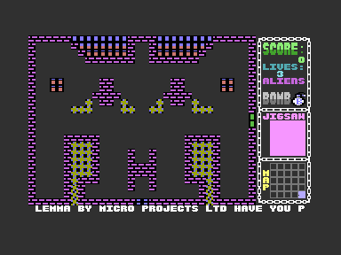

# Dork's Dilemma C16


This project reassembles the surviving **Dork's Dilemma** source for the Commodore 16 and Plus/4 with PlatformIO, VS Code and the cc65 toolchain. I wrote the game at Micro-Projects Ltd. under the development name **Rooms of Peril**. Gremlin Graphics in Sheffield renamed it **Dork's Dilemma** when it published and launched the game in 1985.

Open the [complete HTML handbook](docs/DORKS_DILEMMA.html) for the history, artwork and reviews, restoration, build guides, code analysis, graphics and reference in one offline document. It's generated from the Markdown files, which stay the source of truth. Run `make docs-html` after editing the docs, or `make docs` to refresh the build and analysis as well. [Maintaining the HTML Documentation](docs/HTML_DOCUMENTATION.md) has the details.


---

## Verified Build

The restored build reproduces the surviving `DORKSDIL.BIN` **byte for byte**, all 12,290 bytes of it. Its 7,840 executable bytes are assembled from recovered source. The PRG loads at `$1000` and starts at `$1960` (`SYS 6496`).

In VICE 3.10, on a PAL C16 with 16 KB RAM, the title screen renders and the game reaches its main loop with scripted fire input. I haven't tested the keyboard by hand or played the game through yet. [Restoration Status](docs/RESTORATION_STATUS.md) has the evidence, the source dependencies and what the checks don't cover. Earlier reports of an incomplete display describe the superseded reconstruction.



---

## Build and Run

You need Python 3.9 or later and the cc65 tools (`ca65` and `ld65`), plus VICE (`xplus4`) to run the game. On macOS with Homebrew:

```sh
brew install cc65 vice
./build.sh
scripts/run_vice.sh build/dorks.prg
```

`./build.sh` builds the PRG and checks it against the reference. The launcher waits for the C16 to finish resetting, loads the PRG at its saved address and enters at `$1960`. The PRG has no BASIC `RUN` stub, so the launcher drives the VICE monitor instead of using BASIC autostart.

With PlatformIO Core installed, or from the PlatformIO terminal in VS Code:

```sh
pio run -e c16
pio run -e c16 -t upload
```

PlatformIO runs the same restoration pipeline and writes `build/platformio/c16/dorks.prg`, and the upload target launches VICE. The `c16_debug` environment produces identical game bytes, along with labels, a listing, a map and debug information. More in the [PlatformIO Guide](docs/PLATFORMIO_GUIDE.md).

In the source, the keyboard is `Z` / `X` for left / right, `;` / `/` for up / down, and Space for fire and start. `F1` switches between keyboard and joystick, and `F2` switches sound. How these map to host keys depends on the VICE keymap, and I still need to test them by hand.

---

## Preserved Inputs

The build reads `Dorks-Dilemma-C16-2026-FullDiskCopy/Dorks-Dilemma-C16.d64`, extracts its files without modifying the image, and follows the original `ROOMS OF PERIL` `.LIB` order. Four modules the source includes aren't in the image's live directory, so they come from the 1992 text export in `Original_Files/`. `build/recovery-manifest.json` records where each input came from. The bomb source, which an earlier repair had to guess at, now comes straight from the 2026 image.

Screen data comes from the image's `MUFF` file. The final character set comes from the graphics region of the surviving game binary, because the standalone `CHARS` file differs in 142 bytes. **No executable code is copied from the reference binary.** The graphics still depend on it, though, and I haven't yet built the character set without it.

Generated assembly, extracted working copies and build reports all go into `build/`, which you can delete and rebuild, and the original inputs stay byte for byte as they were. `src/`, `Recovered_Source/`, `disassembly/` and `archive/` keep earlier investigation material and aren't inputs to the current build. [Source to VICE](docs/SOURCE_TO_VICE.md) walks through the process, and [Recovered Disk and Folder Contents](docs/RECOVERED_DISK_CONTENTS.md) catalogues the recovered material.

---

## History and Recovery Background

My development machine was a C64 with a 1541 disk drive. I edited and assembled the source on the C64, then loaded and tested it on the C16 through the shared, daisy-chained drive. This project preserves an authentic version of the game, along with a recovery process I can reuse for other surviving development disks.

[Development History](docs/DEVELOPMENT_HISTORY.md) has my recollections, the original tools, the earlier conversion, the 2026 capture and my photograph of the surviving disks. [Gremlin Archive and the Book](docs/GREMLIN_ARCHIVE.md) covers Mark Hardisty's book and archive, and matches this project's files against the development disks I donated. [Artwork, Packaging, and Reviews](docs/PUBLICATION_ARCHIVE.md) shows the cover art, the cassette inlay and instructions, and scrapbook reviews from 1985 and 1986.

Original programmer: Anthony Clarke, Micro-Projects Ltd. Publisher: Gremlin Graphics Ltd. The original source gives 5 March 1985 as the start of development. The recovery uses ZoomFloppy, OpenCBM and CBM-Transfer, and the [history document](docs/DEVELOPMENT_HISTORY.md#recovery-tool-acknowledgements) credits their authors and contributors.

---

## Learning, Modification, and Ports

[Codebase Analysis](CODEBASE_ANALYSIS.md) explains how the restored game is put together. The [generated code reference](docs/analysis/CODE_REFERENCE.md), [asset data](docs/analysis/asset-data.json) and the room, font and game-graphics sheets in [the analysis folder](docs/analysis/README.md) help with finding your way around the source. There's no modified-game build yet: the restoration target has to match the reference exactly.

---

## Tests and Sharing

```sh
make test
python3 scripts/verify_vice.py
```

Seven regression tests cover the restored build and its inputs. The VICE check covers title rendering and gameplay entry with scripted input, and saves title and gameplay screenshots. I still haven't tested the keyboard by hand, listened to the sound, tried real hardware or played all the way through. See [Testing](TESTING.md).

This is historical software, preserved for study and restoration. The historical copyright notices are all still in place. Whether the surviving reference binary is a release or a development build is unknown. Changes are recorded in the [Changelog](CHANGELOG.md).
