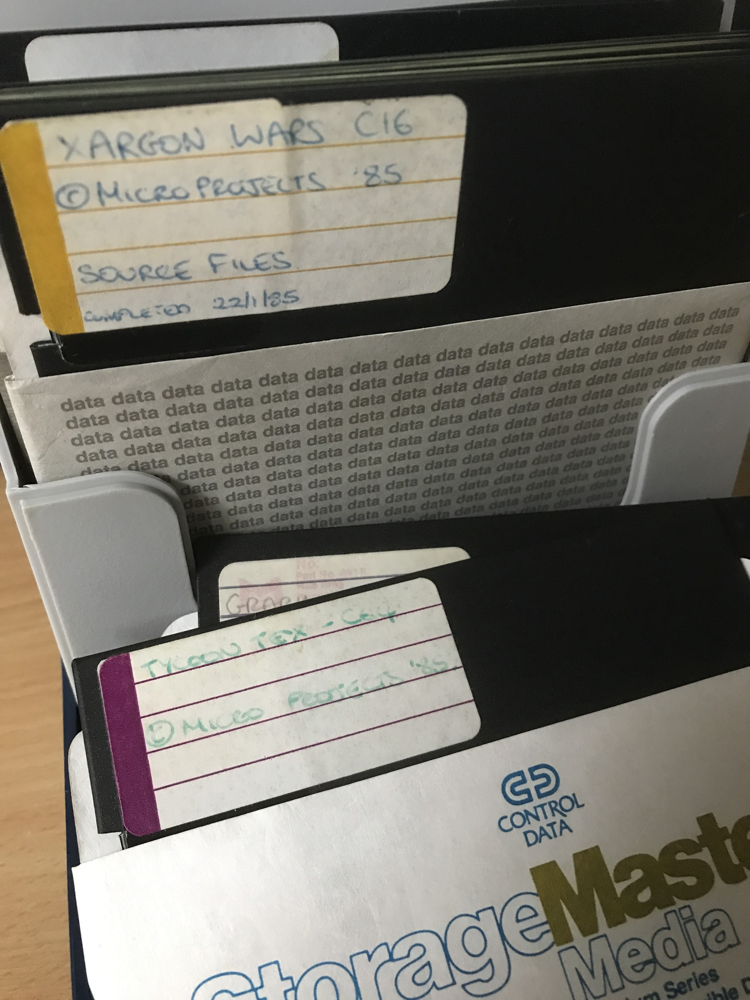

# Development History

## From Rooms of Peril to Dork's Dilemma

I wrote the game under the development name **Rooms of Peril**. Gremlin Graphics in Sheffield renamed it **Dork's Dilemma** when it published and launched the game. I gave the project this naming history in October 2026.

The surviving main source still calls itself `ROOMS OF PERIL`, credits Micro-Projects Ltd. and Gremlin Graphics Ltd., and gives a start date of 5 March 1985. That explains why source files and disk listings use a different title from the published game. The names alone don't say which revision or machine a particular file was meant for.

This project aims to preserve an authentic version of the game from the original development material, and to document a process I can reuse for other games whose source disks survive. The current build reproduces the surviving game binary byte for byte. [Restoration Status](RESTORATION_STATUS.md) lists the source and graphics dependencies and the emulator checks made so far.

[Artwork, Packaging, and Reviews](PUBLICATION_ARCHIVE.md) preserves a selection of my cover scans, cassette inlays, and review scrapbook pages, which show how the game was presented and received at the time.

---

## The Original Development Setup

I recall developing on a Commodore 64 with a Commodore 1541 disk drive. I edited and assembled the source on the C64. The 1541 was daisy-chained to the C16, so the assembled output could be loaded from the shared drive and tested on the C16.

That gives us the development host, the shared storage, and the target machine. The exact editor commands, assembler options, loader sequence, and revisions still need checking against the surviving files.

### Approach Used – To Be Validated

The recovered material suggests the sequence below. It is read from the files, not a tested reconstruction of a whole development session.

1. Start the C64 editing environment using `BOOT ALL`, the source editor, and disk-command support.
2. Edit sequential source files. Assemble the main `ROOMS OF PERIL` file, whose `.LIB` directives bring in the other modules in order.
3. Write hexadecimal object records to an `OBJ` sequential file.
4. Access the output from the C16 through the shared 1541, using a loader to place the object records in memory and to load supporting graphics and data.
5. Enter the game through the C16 monitor, test it, and go back to the C64 to make changes.

The recovered assembler calls itself `CBM RESIDENT ASSEMBLER V080282` and the editor `COMMODORE 64 EDITOR V072982`. A recovered loader calls itself `HILOAD.C64 V072882`. These fit the editor, assembler, and object-loader arrangement described in the [Commodore 64 Macro Assembler Development System manual](https://raw.githubusercontent.com/dmarlowe69/cbm_mads/master/CBM%20Documentation/assembler.txt), preserved as a Project64 transcription by David Holz. What each recovered program did exactly will be researched in a later revision.

The C16 boot program has monitor commands that mention `MEGA*`, `OBJ`, `MUFF`, and `CHARS`, followed by entry at `$1960`. They point to a loading approach, but they don't show that every similarly named file in the recovered collection belongs to the same working setup.

---

## Earlier Conversion and the Current Recovery

I recall sending the original disks off for conversion to modern files, probably in 1992. I don't know how it was done, and I had no way to test the results at the time. The earlier `Original_Files/INDEX` carries 7 October 1992 timestamps, which fit my recollection but don't show how or when the conversion happened.

I later suspected that some source hadn't transferred completely. The earlier `Original_Files/FILLERBO.TXT` stops abruptly at `fild`, and the supplied C16 disk image has the continuation and the missing bomb routines. So the earlier files were incomplete, though it is unclear at what stage the loss happened.

The current capture was done on my Windows 10 workbench computer, with a 1541 drive, ZoomFloppy, OpenCBM, and CBM-Transfer. I chose Windows because it suited the workbench setup I had and because I thought community support was better there. Exact drive and software versions are still to be recorded. OpenCBM also documents macOS support, but I haven't verified a macOS capture procedure for this project.

The files supplied for this recovery are in `Dorks-Dilemma-C16-2026-FullDiskCopy/`. [Recovered disk and folder contents](RECOVERED_DISK_CONTENTS.md) lists the current inventory and names the C16 disk image as the starting point for the restoration.

### Recovery Tool Acknowledgements

[ZoomFloppy](https://github.com/go4retro/ZoomFloppy) connects modern USB computers to Commodore disk drives. Its project description credits designer Nate Lawson, and the [OpenCBM credits](https://opencbm.trikaliotis.net/opencbm-35.html) name Jim Brain and Nate Lawson for XUM1541/ZoomFloppy.

[OpenCBM](https://github.com/OpenCBM/OpenCBM) provides device access and transfer utilities. Its [users guide](https://opencbm.trikaliotis.net/) credits Michael Klein, Spiro Trikaliotis, Wolfgang Moser, and Arnd Menge. The transfer in this project depends on their work.

[CBM-Transfer](https://github.com/sjgray/cbm-transfer), by Steve J. Gray, gives OpenCBM and other disk and file tools a graphical interface. These tools are credited separately from the original game-development software.

---

## Modern Restoration Record

Local Git history shows an initial upload on 20 January 2026, more work on 3 February, and a later commit on 26 April. The first documentation review looked at checkout `d2079d2` and the locally recorded `origin/dev` commit `d1007a5`. Commit `6f3023a` then saved the recovered material and documentation before the current restoration work.

The April commit describes fixes to TED register definitions and a missing decoder instruction, followed by a partly rendered title screen and an unresolved transition into gameplay. The new pipeline reads the recovered original modules instead of extending that consolidated version. It assembles the whole executable to identical bytes and reaches gameplay in VICE with scripted input. Manual controls and a full play-through still need checking. Earlier status reports describe the superseded reconstruction.

Whether `Original_Files/DORKSDIL.BIN` is a release or a development build is unknown. It is a surviving reference binary that earlier project work reported running in VICE. Its exact relationship to each source revision hasn't been established.

---

## Surviving Development Disks

My photograph of the surviving Micro-Projects development disks. It gives historical context for the C16 restoration. I haven't yet matched the photographed disks to individual image files.
