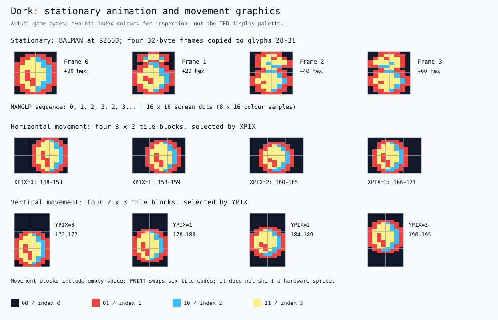
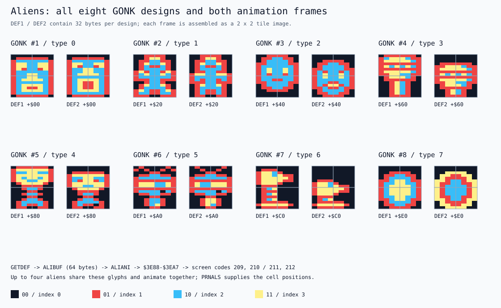
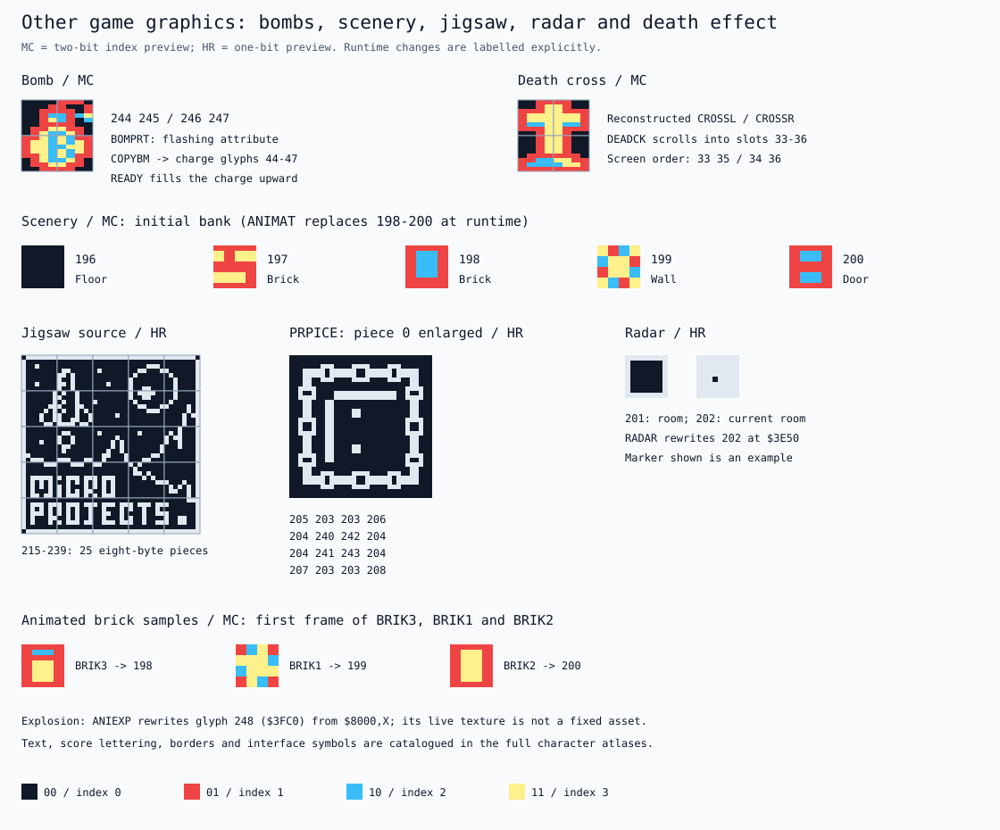
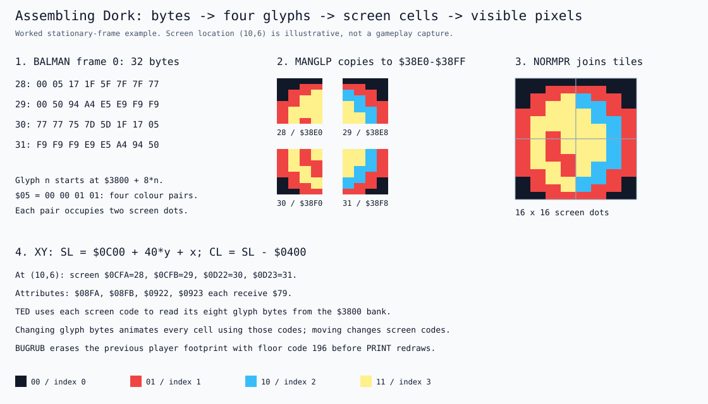
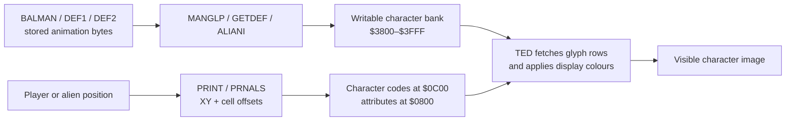
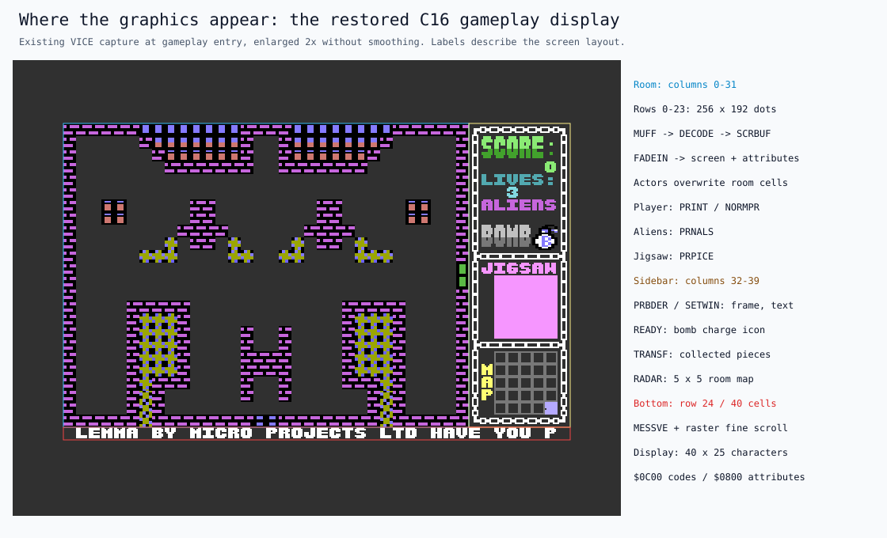
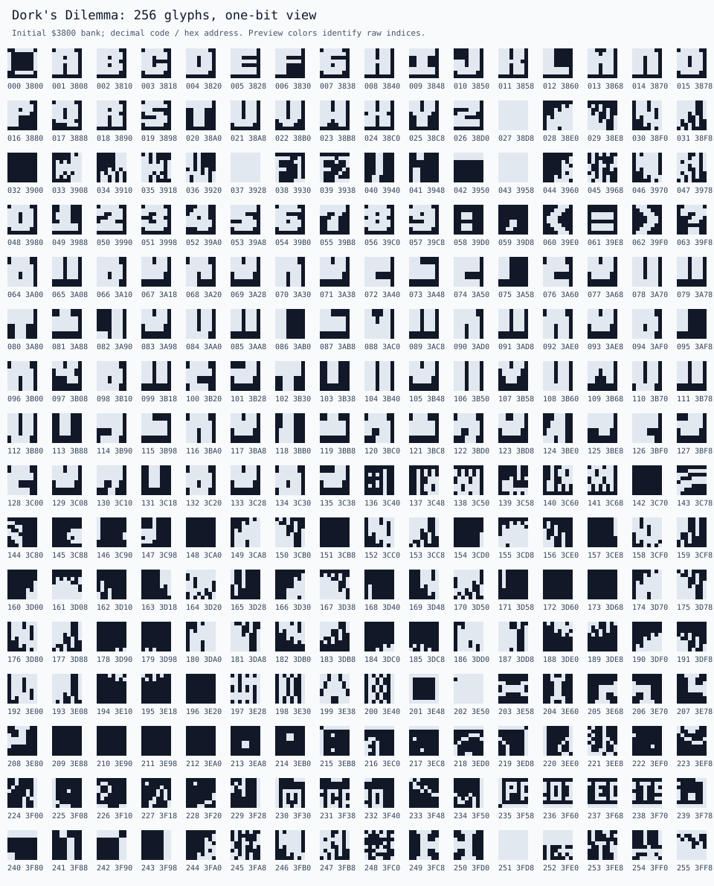
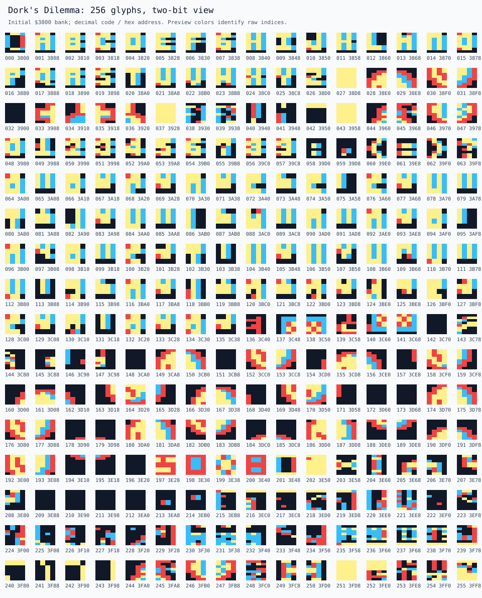

# Illustrated Graphics

## How These Figures Were Made

Every figure in this chapter is generated by `scripts/analyze_codebase.py` (with `scripts/game_graphics.py`) from the original bytes of the verified build, exported in [`asset-data.json`](analysis/asset-data.json). Nothing is redrawn by hand. Run `make docs` to regenerate them after a build. [Codebase Analysis](../CODEBASE_ANALYSIS.md) explains the code that uses these graphics, and the [stored room atlas](../CODEBASE_ANALYSIS.md#stored-room-atlas) shows all 25 room layouts.

---

## Graphics Sources

The current build takes screen data from `MUFF` and the final character set from the reference binary's `$3800–$3FFF` region. Standalone `CHARS` differs in 142 bytes, so producing the final graphics without the reference, from the other assets and utilities, is still a research task. No executable code is copied from the reference.

Character bitmaps, character-screen codes, text encodings, and display attributes are four different representations, and a new platform needs explicit conversions between them. Collision and explosion routines also read character values, so a visual redesign can change gameplay unless those rules are kept apart from the renderer.

Alternative character sets and support programs survive on the disk, but their names don't say what they were used for in production. Work out how they relate to the final game assets before a new edition depends on them.

---

## How to Read the Graphics Sheets

The images below rebuild named game graphics from the **verified PRG's bytes and assembled data tables**, keeping the tile order the drawing routines use. `scripts/game_graphics.py` generates them when `scripts/analyze_codebase.py` runs. They aren't artist impressions, and they aren't guessed from asset filenames.

In the multicolour previews, each byte holds four two-bit samples, shown as four pairs of horizontal screen dots. The four inspection colours stand for the values `00`, `01`, `10`, and `11`. They match the index colours of the existing multicolour atlas on purpose and don't try to emulate the TED palette. The one-bit previews show eight separate dots per byte. The annotated VICE screenshot below shows how the game really looks. The sheets explain the shapes and storage underneath.

---

## Main Character: Dork

The stationary character is a **2 × 2 tile image**, occupying 16 × 16 screen dots. `BALMAN` in `ANIMATE-CHARS` stores four frames of 32 bytes each: eight bytes for the top-left tile, eight for the top-right, then the bottom-left and bottom-right. `MANGLP` copies the chosen frame into `$38E0–$38FF`, which defines character codes 28–31. Its counter visits frames 0, 1, 2, 3, then alternates 2 and 3 while the idle animation continues. `GLOPTM` controls the interval; these are not four frames displayed on every interrupt.

`PRINT` in `MOVE-PIXEL` selects a different representation while moving. Horizontal phases use codes **148–171** in four consecutive six-character groups, placed in a **3 × 2** rectangle using `WALY = 0,1,2,40,41,42`. Vertical phases use codes **172–195** in four six-character groups, placed in a **2 × 3** rectangle using `YVAL2 = 0,1,40,41,80,81`. `TIME6 = 0,6,12,18` selects the group from `XPIX` or `YPIX`. The wider or taller blocks leave space for the shifted image; the entire block is not solid character artwork.

At a cell boundary, `NORMPR` writes codes 28, 29, 30, and 31 in a 2 × 2 arrangement. Its initial pointer can be one row above the final top-left cell, and horizontal facing adjusts the column. The `YCHIN` offsets 40, 41, 80, and 81 account for that positioning. Both stationary and moving player cells receive attribute `$79`. `BUGRUB` clears the previous footprint selectively, replacing player codes with floor code 196.

---

## Aliens: Eight Designs, Two Frames Each

The source calls these designs **GONK #1–#8**; their stored type indices are 0–7. `DEF1` and `DEF2` in `VARIETY` each contain 256 bytes: eight designs × 32 bytes per frame. Each frame has the same top-left, top-right, bottom-left, bottom-right tile order as the stationary player.

`GETDEF` chooses the room's alien design, or reuses the previous type when `DUCK` requests it, and copies its two frames into the 64-byte `ALIBUF` at `$024B`. `ALIANI` alternates between the two 32-byte halves and copies the selected frame to `$3E88–$3EA7`, defining codes **209–212**. The animation countdown reloads with 20; it is separate from the alien movement tempo.

`PRNALS` maintains four alien slots. For each live slot it erases the previous four screen cells with code 196, then writes **209, 210 / 211, 212** at the new address, with attribute `$7C`. All live aliens share those four glyph definitions, so they share a design and animation phase. Their positions live in separate movement and print tables. Eight designs therefore do not imply eight independently selected designs on one screen.

---

## Bombs, Scenery, Jigsaw, Radar, and Effects

| Graphic            | Codes or storage | Assembly and drawing      |
| ------------------ | ---------------- | ------------------------- |
| Planted bomb       | 244–247          | `BOMPRT`, 2 × 2 tiles     |
| Bomb charge icon   | 44–47            | `COPYBM` and `READY`      |
| Explosion fill     | 248 / `$3FC0`    | `FILBMB` and `ANIEXP`     |
| Floor and scenery  | 196–199          | `DECODE` and `FADEIN`     |
| Door               | 200              | `DOORDT` overlay          |
| Radar room markers | 201–202          | `RADAR`, 5 × 5 cells      |
| Box edges/corners  | 203–208          | Jigsaw and sidebar frames |
| Jigsaw pieces      | 215–239          | One eight-byte glyph each |
| Enlarged piece     | 240–243          | `PRPICE`, 2 × 2 tiles     |
| Death animation    | 33–36            | `DEADCK`, mutable glyphs  |

**Bomb and explosion.** `BOMPRT` writes codes 244, 245 / 246, 247 using the first four `YVAL2` offsets. It changes the attribute during the countdown to flash the bomb. `COPYBM` copies the same 32 bitmap bytes from `$3FA0` into the sidebar charge glyphs at `$3960–$397F`. `READY` rebuilds the charge image upward over time. Explosion cells use code 248; `ANIEXP` continually replaces that glyph's eight bytes using reads from `$8000,X`. Its live texture therefore cannot be represented by one definitive stored frame.

**Scenery and borders.** The packed room data selects codes 196–199, then the decoder inserts doors as code 200. `ANIMAT` copies `BRIK3`, `BRIK1`, and `BRIK2` frames into codes 198, 199, and 200. It also animates horizontal and vertical border glyphs 203 and 204 using `XDAT` and `YDAT`. The initial bank and runtime appearance consequently differ even when no actor moves. The sheet includes both initial scenery and the first replacement brick frames.

**Jigsaw.** Codes 215–239 contain the 25 small, one-bit jigsaw pieces. `PRPICE` selects a piece through `JIGNUM[SCREEN]`, copies its eight bytes into `JIGBUF`, and uses `XPAND` to duplicate each bit horizontally, then duplicates rows vertically. This creates four glyphs at `$3F80–$3F9F`. Their arrangement is **240, 242 / 241, 243**, because the expansion stores the entire left column before the right. `JIGCHR` surrounds them with a 4 × 4 cell frame; the piece cells use attribute `$42` and the frame uses `$71`. `TRANSF` later places the original small glyph in the sidebar's collection area.

**Radar and death.** `RADAR` places 25 room-marker characters in the sidebar. It rewrites code 202 at `$3E50` with a marker derived from `MANX` and `MANY`, then uses that glyph for the current room; the sheet's marker is an illustrative position. `DEADCK` copies the player's current stationary glyphs into temporary codes 33–36, arranged **33, 35 / 34, 36**, scrolls them away, and scrolls in the `CROSSL` and `CROSSR` pattern. The cross shown is reconstructed from those pattern tables, rather than presented as an unchanged initial-bank asset.

---

## From Bitmap Bytes to Visible Screen Cells

The game uses a character display. Moving figures are drawn in software by changing screen cells and writable character definitions, and the drawing code doesn't allocate a hardware sprite for Dork or an alien. For character code `n`, the bitmap starts at **`$3800 + 8*n`**, and each of its eight bytes is one row.

`XY` converts a cell coordinate into `SL = $0C00 + 40*y + x` and `CL = SL - $0400`. The screen holds character numbers, and the matching attribute cells set the display colours and how each cell is read. For example, placing stationary Dork at top-left cell `(10,6)` writes codes 28, 29, 30, and 31 at `$0CFA`, `$0CFB`, `$0D22`, and `$0D23`, and attributes `$08FA`, `$08FB`, `$0922`, and `$0923` each get `$79`. The coordinate is a worked example and doesn't say where the player is in the capture.

`SETUP` selects RAM character graphics and the bank at `$3800`, turns on the game's display mode, and sets `BACKGR`, `MULTI1`, and `MULTI2` to `$11`, `$00`, and `$46`. Display colours can change later during the title, fades, and effects. A screen code can animate without moving when its eight glyph bytes change, and movement changes which codes sit in which cells instead. A port has to reproduce both.

---

## How the Whole Screen Is Composed

The character screen has **40 columns × 25 rows**, representing 320 × 200 screen dots before border and emulator scaling. The room uses columns 0–31 and rows 0–23, or 256 × 192 dots. The sidebar uses columns 32–39. Row 24 contains the scrolling message. The rectangles above mark those regions on the existing gameplay-entry capture; they do not add game content to the screenshot.

`DECODE` expands the selected room into `SCRBUF` with a 40-byte row stride. `FADEIN` copies scenery and door codes to `$0C00` and their attributes to `$0800`, varying the brightness during the transition. Blank cells in the room use code 196. `PRPICE` adds the central jigsaw display, and the actor and bomb routines overwrite cells as play goes on. It's one shared tile surface, not a stack of separately composited image layers, and the screen codes also feed collision and hit detection.

`PRBDER` and `SETWIN` build the sidebar frame and labels, `READY` updates its bomb icon, `TRANSF` populates the collected-piece area, and `RADAR` draws the map. The bottom message uses `MESSVE` and raster-controlled fine scrolling. `RAST1` restores the main area's display settings and calls `ANIMAT`; the alternating `RAST2` service scrolls the message, then performs `UPBOMB`, `PRNALS`, and `MOVEMN` when gameplay is enabled. See the interrupt diagram above for the scheduling detail.

---

## One-Bit Character Atlas

*All 256 initial eight-byte glyphs from `$3800–$3FFF`, shown as eight one-bit pixels per row. Labels give the decimal character code and hexadecimal byte address. This view makes text and fine patterns easier to inspect.*

---

## Two-Bit Character Atlas

*The same bytes interpreted as four two-bit pixel pairs per row. Preview colours identify raw indices; they are not a reconstruction of TED palette selection. Actual display depends on character attributes, display settings, and runtime changes to character memory.*

Both views are worth having, because how a byte is read depends on the display mode. The sheets show only the initial bank. `ANIMATE-CHARS`, `VARIETY`, and other drawing code change glyph contents at runtime, so no sheet can show every animation frame or presentation state.
