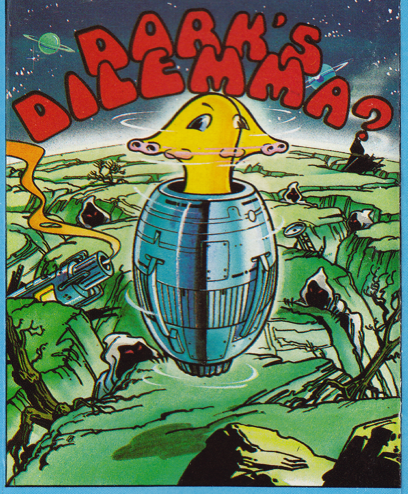
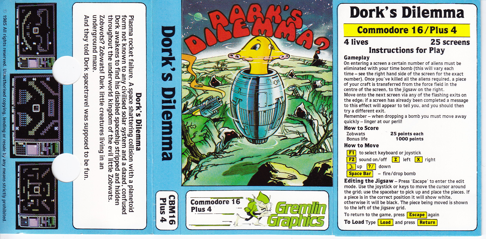
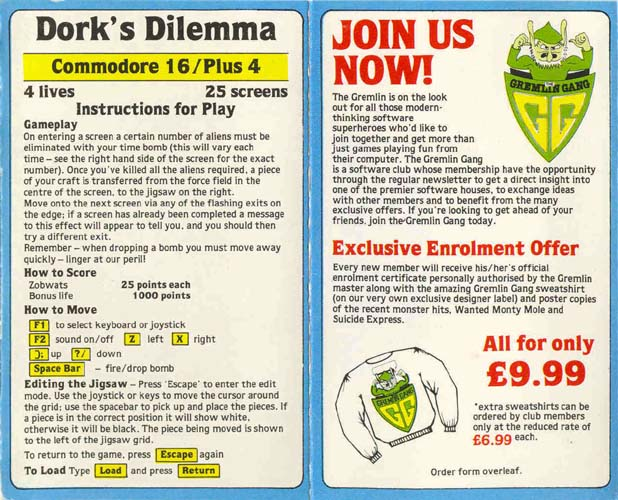
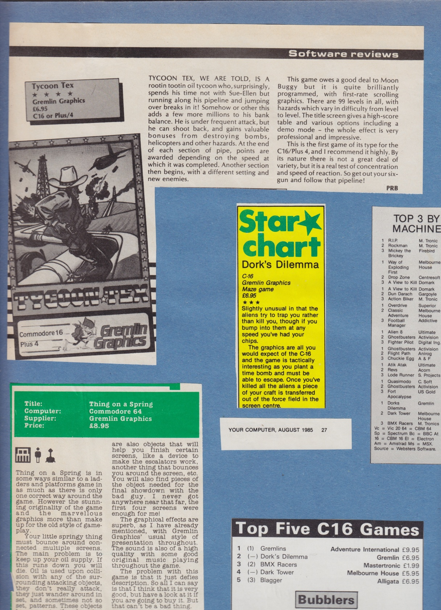
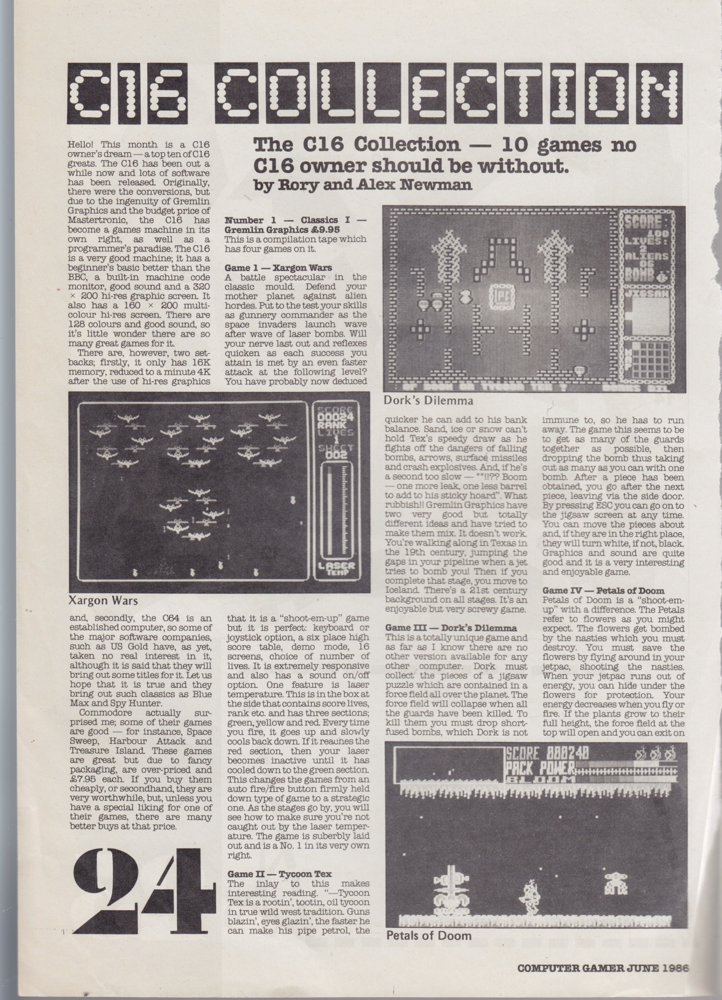

# Dork's Dilemma – Artwork, Packaging, and Reviews

## About This Collection

This selection from my personal archive shows how **Dork's Dilemma** was presented to players and reviewed in print: the cover illustration, the cassette packaging, and two scrapbook pages from 1985 and 1986. I supplied the material for this repository in October 2026.

The images are supporting evidence only. The printed instructions, review descriptions, and screenshots may describe a different revision from the surviving reference binary. [Development History](DEVELOPMENT_HISTORY.md) covers the game's origins as **Rooms of Peril**, and [Codebase Analysis](../CODEBASE_ANALYSIS.md#game-graphics-assembly-and-screen-display) explains the graphics the restored program uses.

---

## Cover Illustration

*Cover scan supplied as `Dorks Dilemma Image.jpg`, copied without alteration.*

The illustration shows Dork in a metallic craft above a broken alien landscape, with the title in red lettering. The same scene is on the cassette inlay below. This is packaging artwork. The character tiles and room graphics the C16 displays are covered separately in the codebase analysis. The scan doesn't name an illustrator.

---

## Cassette Packaging and Instructions

### Full Inlay

*Full inlay supplied as `Dorks Dilemma Cassette Inlay.jpg`, copied without alteration. Open the image to read the printed instructions at full resolution.*

The inlay names **Gremlin Graphics**, **Commodore 16/Plus 4**, and **25 screens**, and carries a 1985 copyright notice. Its story has Dork's damaged spacecraft scattered through the underground world of the Zobwats. The printed screenshots show the room area, the central jigsaw piece, and the right-hand status panel.

The instructions tell the player to use time bombs to kill the number of aliens a room requires, move a spacecraft piece to the jigsaw, and leave through flashing exits. They give 25 points for a Zobwat and a bonus life at 1,000 points. The jigsaw editor is entered and left with Escape, using the movement controls and Space to pick up and place pieces. Correctly placed pieces turn white, and the rest are black.

The printed controls are `F1` for keyboard/joystick, `F2` for sound, `Z` and `X` for horizontal movement, and Space to drop a bomb. The [README's build and run instructions](../README.md#build-and-run) give the source-derived controls and say what the emulator testing hasn't yet covered.

**Revision detail:** the inlay advertises **four lives**, but the restored reference binary starts with **three**, as [Codebase Analysis](../CODEBASE_ANALYSIS.md#startup-title-and-foreground-loop) shows. The scan records the packaging claim. It doesn't say which program revision shipped with that inlay.

### Reverse Panel and Gremlin Gang Insert

*Reverse panel supplied as `dorks_dilemma_side.jpg`, copied without alteration.*

This view shows the instructions next to the **Gremlin Gang** membership promotion. The £9.99 enrolment package advertised a certificate, a sweatshirt, and poster copies of cover artwork. It shows how the publisher presented its games at the time. The membership offer is separate from the game's retail price.

---

## Reviews and Charts

### Your Computer – August 1985

*Complete page 12 of `Scrapbook - C16.pdf`. The yellow review comes with a label reading `YOUR COMPUTER, AUGUST 1985` and printed page number 27. Scrapbook page numbers here count from the first PDF page.*

The **Star chart** clipping gives Dork's Dilemma **three stars** and a price of **£6.95**. The short review picks out the aliens that try to trap the player and the need to get away after planting a bomb. It also describes the spacecraft piece moving from the centre of the room into the jigsaw.

A separate **Top Five C16 Games** clipping at the bottom of the page puts Dork's Dilemma second, also at £6.95. That clipping shows no publication or issue date in this scan, so it isn't assumed to share the labelled review's provenance. The full scrapbook page is kept to show these items in context, next to material about other games.

### Computer Gamer – June 1986

*Complete page 15 of `Scrapbook - C16.pdf`, preserving printed page 24 of `Computer Gamer`, June 1986.*

The feature **The C16 Collection**, credited to **Rory and Alex Newman**, covers a four-game Gremlin **Classics I** compilation priced at **£9.95**. Dork's Dilemma is **Game III**, with a gameplay screenshot, alongside Xargon Wars, Tycoon Tex, and Petals of Doom.

The Dork's Dilemma text describes collecting spacecraft jigsaw pieces, clearing force fields by killing guards with short-fuse bombs, and arranging the pieces in the Escape-key editor. It finishes with a favourable verdict on the graphics, sound, and enjoyment. This is a later compilation review, so it isn't evidence for the original standalone cassette's price or exact contents.

---

## Sources and Preservation

The three packaging images are unmodified copies of the supplied JPEGs. The two review images are full PDF-page renders at 144 dpi, saved as JPEGs without cropping or retouching. Original publisher notices and printed credits stay visible. Captions keep supplied filenames, PDF page numbers, and printed magazine references apart.

The [asset provenance manifest](images/publication/provenance.json) lists source filenames, checksums, selected PDF pages, and rendering details. The copies live in `docs/images/publication/`, so the document doesn't depend on paths on my computer. The full 17-page scrapbook covers other games too and hasn't been duplicated here.

The selection uses one detailed cover scan and one full inlay rather than repeating the similar artwork variants and smaller inlay images in the supplied collection. Publication details are transcribed only where they are visible in the material. No magazine attribution or artwork credit has been guessed from filenames.
