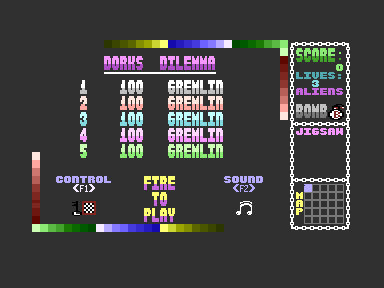

# Restoration Status

## Verified Result – 19 October 2026

The restored build produces a PRG identical to the surviving reference binary. All executable code is assembled with ca65 and linked with ld65 from source. The final graphics data is supplied separately, as described below.

| Measurement                | Verified value            |
|----------------------------|---------------------------|
| Executable code            | 7,840 bytes               |
| Complete PRG               | 12,290 bytes              |
| PRG load address           | `$1000`                   |
| Entry address              | `$1960` / `SYS 6496`      |
| Differences from reference | 0 bytes                   |
| Emulator configuration     | VICE 3.10, PAL C16, 16 KB |
| Regression tests           | 7 passing                 |

The output and `Original_Files/DORKSDIL.BIN` share this SHA-256:

```text
3c6f6426b93862de9bd836842f1ffc0bc46f19056e2fc0706ca0da8037a7ce05
```

The reference inside the disk image matches that earlier binary copy too. So the build reproduces the surviving binary. Whether that binary is a release or a development build remains unknown.

---

## Source Recovery

The supplied C16 image has 66 live directory entries. Its `FILLER-BOMB` has the continuation missing from the earlier `FILLERBO.TXT`, including `FILLEX`, `CHKBMB`, and `CLEXP`, and those routines are now assembled directly from recovered source.

Four active `.LIB` references have no matching file in the image's live directory:

| Original module    | Earlier surviving input       |
|--------------------|-------------------------------|
| `RASTER-ROUTINES`  | `Original_Files/RASTERRO.TXT` |
| `ALIENS-MEGA/CODE` | `Original_Files/ALIENSME.TXT` |
| `ALIEN-CHEK/PRINT` | `Original_Files/ALIENCHE.TXT` |
| `WHOOPPEE-MESSAGE` | `Original_Files/WHOOPPEE.TXT` |

The build uses these specific older copies and restores upper-case source from the earlier PC text export. Matching every executable byte checks the resulting instructions and data against the surviving game. It doesn't prove the four files were in the supplied image, and it doesn't recover their original file bytes.

Every extracted file and fallback input is listed with its source and hash in `build/recovery-manifest.json`. The loose files beside the image are not build inputs.

---

## Why the Earlier Rebuild Failed

The old conversion dropped instructions that sat after labels, and it turned register equates into labels by mistake. Examples include the decoder's `SELFMD LDA $FFFF,X`, `LMIRR LDA $FFFF,X`, and `RMIRR STA $FFFF,Y`. Because the decoder modifies itself, losing these instructions also makes it overwrite the wrong bytes.

The April commit repaired some of these defects. The current pipeline reads the original modules afresh and keeps their instructions, register definitions, strings, macros, and memory layout. It doesn't depend on the earlier hand-consolidated source or the guessed bomb routines.

The original `SCRBUF = $0400` stays. It is the decoder's off-screen buffer, and the original display routines also use screen memory at `$0C00`. Pointing every buffer reference at the visible screen address wasn't needed to convert the syntax.

---

## Graphics Dependency

The image's `MUFF` supplies 2,400 bytes of screen data at `$1000`. Assembled code occupies `$1960–$37FF`, and the character set occupies `$3800–$3FFF`.

The standalone `CHARS` file differs from the surviving game's character set in 142 bytes, within `$3C40–$3FC7`. So the build takes only the character-set region of the reference binary, and names it as a graphics asset. All 7,840 executable bytes still come from assembly.

Generating the exact final character set from the other original assets and development utilities is future research. The original standalone file is kept in the generated disk extraction.

---

## Build and Emulator Verification

The direct build, the Makefile build, and both PlatformIO environments all use `scripts/restore_c16.py`, and the PlatformIO environments produce the same PRG as the direct build. Seven regression tests cover the complete PRG, the assembled executable bytes, the explicit fallback dependencies, the recovered bomb routines, the earlier conversion failures, missing includes, and a cyclic disk-sector chain.

VICE's `c1541` extracted `FILLER-BOMB` and the reference PRG independently, and those bytes matched the output of the new disk reader. VICE 3.10 then ran the restored PRG on a PAL C16 with 16 KB RAM.

### Title Screen



### Gameplay Entry


The repeatable emulator check stops at the original fire-input test, sets the `JFIRE` input flag, and resumes the original code. It reaches the main `LOOP`, confirms `TITLE = 0` and `LIVES = 3`, and captures the room display. It doesn't patch any instructions or jump past the game's initialization.

The native UI connection timed out during keyboard testing. Manual keyboard mapping, joystick input, sound, bomb mechanics, room transitions, and a full play-through haven't been verified in this session. Byte equality shows the program bytes match the surviving reference. It doesn't mean the game has been played exhaustively, and it hasn't been tested on physical hardware.

---

## Checkpoint and Earlier Reports

Commit `6f3023a` saves the documentation, recovered collection, and photograph from before this restoration work. The new work uses that checkpoint's inputs and doesn't overwrite the recovered image or older source files.

Earlier reports such as `FINAL_STATUS.md`, `BUILD_SUCCESS.md`, and `DISASSEMBLY_REVERSE_ENGINEERING.md` describe the previous reconstruction, and their completeness claims and build instructions are out of date. For the current process, use this document, [Source to VICE](SOURCE_TO_VICE.md), and the root `README.md`.
